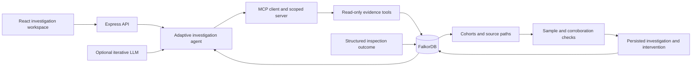

# ReturnTrace

**Follow the connections behind product returns. Turn evidence into the next operational step.**

ReturnTrace is a local web app for Graph Hacks, Track 01: Agents That Act on Connected Data. It investigates an elevated return rate by traversing a FalkorDB commerce graph, comparing competing explanations, saving the investigation, and creating an intervention task.

## Run in VS Code

Open `ReturnTrace.code-workspace` (or this folder) in VS Code. Requirements: Node.js 22.12+ and Docker Desktop with its Linux engine running.

On this Windows computer, the included launcher also detects Codex's bundled Node.js runtime:

```powershell
.\start.ps1
```

The launcher reuses an available FalkorDB connection. On this computer, Docker Desktop has a container named `returntrace-db` with the database on port 6380 and a `returntrace_graph` data volume. If it is stopped, the launcher starts that existing container. The app's VS Code task uses this launcher; **Run ReturnTrace (this Windows computer)** uses the bundled Node runtime directly. Stop an already-running app before launching a second copy on port 4317.

For a standard Node.js setup:

```sh
npm install
# Windows: copy .env.example .env
# macOS/Linux: cp .env.example .env
docker compose up -d falkordb
npm run dev
```

Open **http://127.0.0.1:4317**. The first successful FalkorDB connection seeds the synthetic dataset. If the database is still starting, click **Reconnect FalkorDB**. The Windows launcher builds and serves the production app by default; rerun it after editing the frontend. For hot reload in a normal unrestricted terminal, use `start.ps1 -Development` or `npm run dev`. Vite's development dependency compiler cannot traverse parent folders in the restricted Codex shell on this computer; the production build and server are verified here. VS Code's Run and Debug panel includes **Run ReturnTrace**.

The Compose setup publishes FalkorDB on `127.0.0.1:6380` and its browser on `127.0.0.1:3001`. A named volume preserves graph data. `docker compose stop` stops a Compose-managed database without deleting the volume. The existing Docker Desktop container publishes only the database port; its browser is not published. Docker Desktop's port form uses all host interfaces, so keep this synthetic demo local and leave the Windows firewall prompt denied. Use the loopback-bound Compose configuration for a fresh setup.

For FalkorDB Cloud, set `FALKORDB_URL` in `.env` and use `start.ps1 -SkipDatabase`. Keep credentials out of source control. `.env` is ignored.

## What to demonstrate

The workspace follows a returns operator's review: **Returns review** prioritizes elevated rates, **Case files** holds the evidence, **Return records** filters the source orders, and **Inspection queue** tracks approval and outcomes. Each case separates Findings, Connections, Source records, and the technical Run log. The review shows saved findings alongside the next task, with a compact product layout on narrow screens.

1. **Aura Pro → Lyra Travel:** Aura's suspicious batch has 32/80 returns versus 8/160 elsewhere. A batch → component lot → other batch → product traversal finds DSP-X17 shared with Lyra, which independently has 24/80 versus 8/160. Both signals survive four courier comparisons. The next step is a shared-component inspection. The scope panel shows 160 delivered orders, 56 returns, and two connected products; these are cohort counts, not a claim that every unit is faulty.
2. **Pulse Mini Speaker:** 27/60 returns with ParcelFlow versus 9/180 elsewhere. The signal survives three batches, so the agent proposes a courier audit and skips the component expansion.
3. **Nova Studio Earbuds:** no concentrated signal; the agent abstains and skips unnecessary expansion.
4. **Inspect and rerun:** approve the previewed ticket, record a structured confirmed/refuted/inconclusive inspection, then rerun either connected product. A refuted lead changes the recommendation to independent review. Label simulated inspections clearly. New cases save both the cohort-only finding and the finding informed by inspections. The decision check shows whether the next action changed or was retained; it does not imply a measured reduction in returns.

The graph UI samples up to six source paths for readability; the Source Records tab and JSON export include the retrieved evidence. Sampling is explicitly labeled. Node selection highlights relationships. Query disclosures expose the tool's Cypher and parameters.

## Architecture



**Frontend:** React, Vite, Lucide, custom CSS and interactive SVG.

**Backend:** Node.js, Express, Zod, official `falkordb` client and MCP TypeScript SDK. Cypher queries are parameterized. The client does not send arbitrary Cypher or provider credentials.

**Graph:** `Customer → PLACED → Order → CONTAINS → Unit → FROM_BATCH → Batch`; units connect to products, orders to couriers/warehouses/addresses, customers to devices, and returns to orders. Batches connect through `USES_COMPONENT` to component lots and `SUPPLIED_BY` to suppliers. Investigations, interventions, approved tickets, and inspections are persisted in the same graph. `Inspection → TESTS → ComponentLot` makes a reported outcome available to investigations of connected products.

**Data:** 1,920 synthetic orders, two mature 960-order cohorts, 8,866 commerce nodes, 15,575 commerce relationships, four products, 24 batches, 23 component lots, one supplier, four couriers, and two warehouses. The current cohort contains 120 returns (12.5%); the previous cohort has a 5% return rate. As of October 15, 2026, all orders have a complete 30-day observation window. The dataset marker adds one node; investigation records increase counts further. A repeatable additive v1 → v2 migration preserves saved history and outcomes.

## Agent modes and MCP

The default **adaptive evidence-policy agent** requires no model key. It retrieves prior outcomes, compares batches/couriers/warehouses, then selects follow-up checks from the results. A strong cohort triggers confounding checks; a corroborated batch triggers a cross-product component traversal. Weak signals abstain. Account context runs only when the question requests it. Every evidence read uses an actual MCP client/server session through the SDK's in-memory transport; the tools are scoped to the chosen product, read-only, and reject extra arguments.

The optional **adaptive LLM agent** sees fresh structured observations on each follow-up round and selects among the currently eligible tools. Configure `LLM_BASE_URL`, `LLM_API_KEY`, and `LLM_MODEL` privately in `.env`, then restart. `LLM_MAX_ROUNDS` caps provider requests at three per investigation. The provider receives the product, question, aggregate evidence and relevant inspection notes. Source customer records and credentials are not put in the prompt. Unsupported tool calls or provider failures fall back to the evidence policy. Required checks and numerical conclusions remain enforced by the application. Iterative selection and failure paths are tested with mocks. A live Groq investigation was verified on October 17, 2026 with `openai/gpt-oss-20b`: three successful model selections, seven MCP evidence checks, and no policy fallback.

For Groq, use `LLM_BASE_URL=https://api.groq.com/openai/v1` and a model available to your account. The example uses `openai/gpt-oss-20b`; GPT-OSS 20B and 120B on Groq receive low reasoning effort and a 1,024-token completion ceiling per request so reasoning leaves room for the tool call. The Run log shows the request count and which steps were selected by the model. See [Groq's model documentation](https://console.groq.com/docs/models) for current availability. No key is included in the source archive.

External MCP clients can connect to the same scoped evidence tools over stdio:

```sh
node --env-file-if-exists=.env server/mcp-stdio.mjs SKU-AURA
```

Configure that command, project working directory, and product argument in the MCP client's server settings. No arbitrary Cypher, ticket publishing, or graph writes are exposed through MCP.

## Evidence requirements

A candidate needs at least 30 orders in each comparison group, at least five returns, an eight-percentage-point difference, at least 2× relative rate, and separated 95% Wilson intervals. Batch and courier findings must also persist in at least two sufficiently populated comparison strata. Shared-component leads must independently pass rate and courier-stratum checks in at least two products. Warehouse-only signals are conservatively downgraded because the current prototype does not stratify that dimension.

These are exploratory screening rules, not causal proof, a calibrated probability, or a multiple-comparison-adjusted statistical test. An inspection must confirm the cause. The app never labels a household fraudulent merely because accounts share an address.

## Interventions and memory

An investigation creates a **draft task**. Preview its evidence and checklist, then approve it to create a persistent `Ticket` node. Download the ticket as Markdown. Resolving requires a structured result, tested sample count, units reproducing the suspected failure, and a note. Reported outcomes inform subsequent decisions; they do not change historical return counts. Refuted or conflicting results create an independent-review recommendation. Legacy free-text notes are recalled but never interpreted as verified structured results.

Repeated investigations reuse a non-dismissed task with the same product, type, and target. The state transitions are draft → approved → resolved, or draft/approved → dismissed. Writes are serialized per action within this server process.

Optional GitHub publishing requires `GITHUB_REPOSITORY=owner/repo` and `GITHUB_TOKEN` with Issues read/write access to that repository. After local approval, open the ticket and explicitly choose **Send ticket to GitHub**. The destination and exact body are shown first. Retries check a stable marker in open and closed issues before creating a new issue; the connector refuses to send if its bounded lookup cannot establish retry safety. This connector was tested with mocked GitHub responses, not a real repository. The agent cannot publish issues or change inventory/refunds.

This prototype has one local workspace and serializes investigations in one server process. It is not a multi-tenant production service. Bind to loopback by default; add authentication, deployment controls, and robust transactional uniqueness before exposing it publicly or scaling to multiple server processes.

## Verification

```sh
npm test                  # Logic, safety boundaries, persistence in fixture adapter
npm run evaluate          # Four products and three planted patterns on FalkorDB
npm run test:integration  # Actual FalkorDB query parity, persistence, reconnect
npm run build             # Production frontend build
npm run format:check      # Consistent source formatting
```

Integration tests create a fresh graph with a generated `returntrace_test_...` name, seed it, verify queries and memory, then delete only that graph. They never delete the app's graph. `docs/VERIFICATION.md` records the actual checks completed on this computer.

## FalkorDB is required

The application, seed command, evaluation, and MCP entry point require FalkorDB. If it is unavailable, evidence endpoints return 503 and the workspace offers reconnection. There is no runtime fixture option or silent fallback. `tests/support/fixture-store.mjs` is injected by the isolated test harness so unit and API tests can run without a database; the real integration suite separately checks Cypher parity and graph persistence.

## AI assistance and participant contribution

OpenAI Codex substantially assisted with implementation, interface design, debugging, automated tests, and documentation. The participant selected and developed the returns-investigation use case, directed the product workflow and visual revisions, and supplied the local setup and provider access. This is an AI-assisted submission; the source is not represented as entirely handwritten.

Automated and browser verification were carried out with Codex assistance. Those checks do not replace the participant's own review or understanding. Before submission, the participant should personally run the demo and explain the graph model, comparison denominators, tool-selection policy, and inspection feedback. `docs/CODE_GUIDE.md` provides that walkthrough.

## Files

- `server/data.mjs`: reproducible synthetic graph generator
- `server/queries.mjs`: graph traversal and cohort queries
- `server/store.mjs`: FalkorDB persistence
- `server/investigator.mjs`: investigation orchestration and follow-up selection
- `server/analysis.mjs`: named screening rules and comparison checks
- `server/connected-evidence.mjs`: shared-component checks and inspection recall
- `server/interventions.mjs`, `shared/action-types.mjs`: task construction and shared task identity
- `server/model.mjs`: optional bounded model calls
- `server/evidence-tools.mjs`, `server/mcp-stdio.mjs`: MCP tools and transports
- `server/workflow.mjs`: ticket drafts and optional GitHub publishing
- `server/index.mjs`, `server/app.mjs`: entry point, API and app server
- `src/app.jsx`: workspace navigation, investigation state, and dialogs
- `src/pages/`: returns review, case files, source records, and inspection queue
- `src/components/`: evidence views, graph, ticket forms, and shared controls
- `src/hooks/`, `src/lib/`: workspace loading, API calls, and display helpers
- `src/styles.css`: shared styles and responsive layouts; system fonts require no external font request
- `docs/CODE_GUIDE.md`: reading order and extension points
- `docs/DEMO.md`: recording script
- `docs/SUBMISSION.md`: submission draft and honest limitations

Official references: [hackathon](https://www.wemakedevs.org/hackathons/falkordb), [FalkorDB Node client](https://github.com/FalkorDB/falkordb-ts), [Cypher documentation](https://docs.falkordb.com/cypher/), [MCP SDK](https://github.com/modelcontextprotocol/typescript-sdk/tree/v1.x), [GitHub issues API](https://docs.github.com/en/rest/issues/issues#create-an-issue).

Run `npm run format` after changing source. `.editorconfig` and `.prettierrc.json` keep indentation and formatting consistent.

